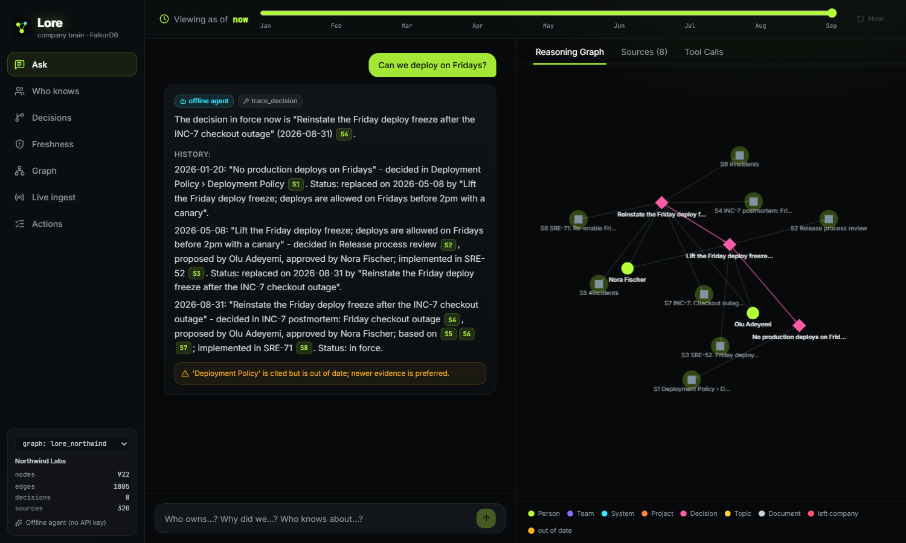
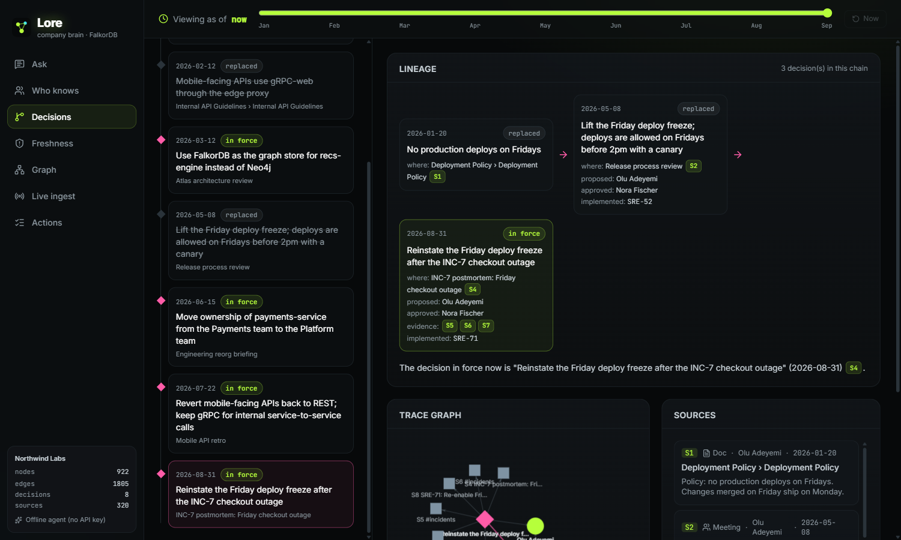
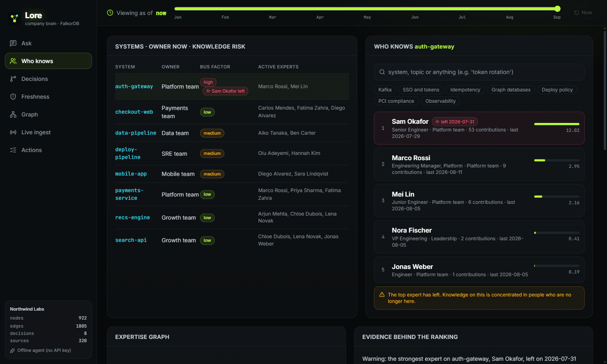
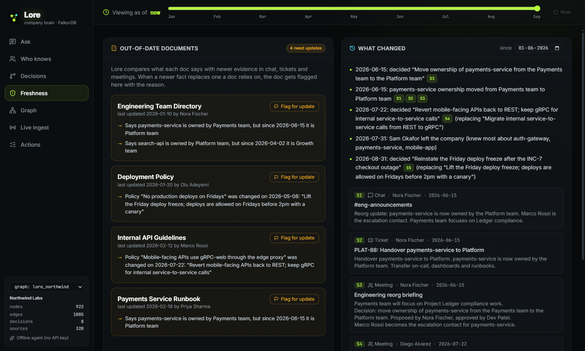
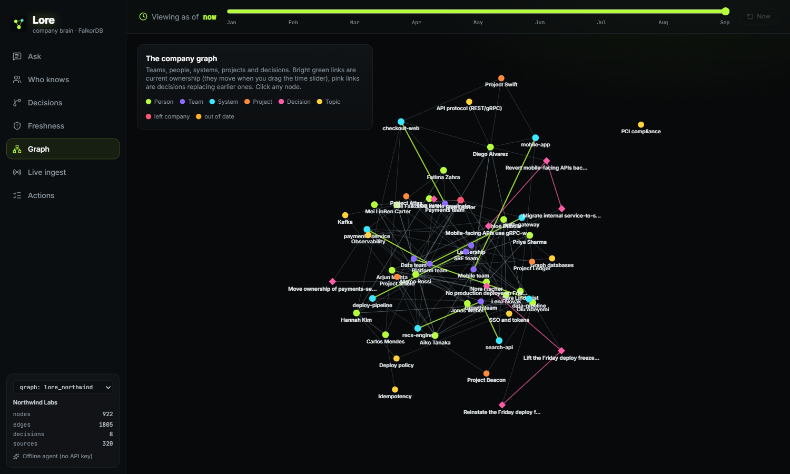
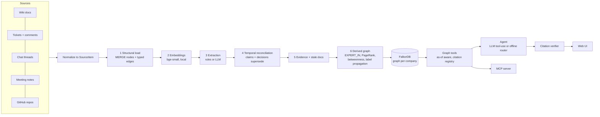
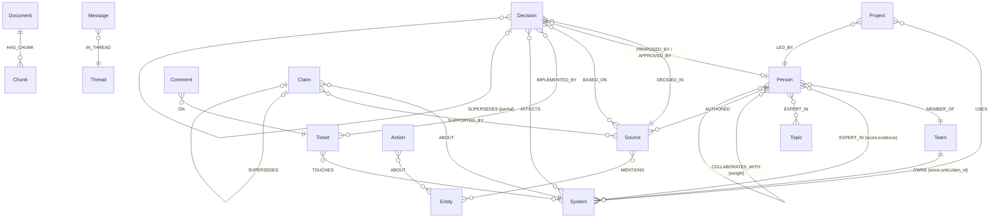

# Lore: the company brain that cites its sources

**Graph Hacks: Context for AI Agents (WeMakeDevs × FalkorDB). Track 03: Company Brain.**

Lore turns a company's docs, tickets, chat and meeting notes into one FalkorDB graph of people, teams,
systems, projects, documents and decisions. An agent works over that graph to answer "who owns this?",
"who actually knows this?" and "why did we decide that?". Every sentence it writes cites its source. It also
**tracks how knowledge changes over time**, so it can tell when a doc is out of date, what changed and when,
and what the answer would have been on any past date.



> **Demo video:** _link_ · **Live demo:** _link_ · **Blog post:** _link_

---

## What it does, mapped to the Track 03 brief

| Track focus | What Lore does | Where |
|---|---|---|
| **Knowledge from docs, tickets and chats in one graph** | Connectors for wiki docs, tracker tickets and comments, chat threads, meeting notes, and **real public GitHub repos** (issues, PRs, comments, README/docs, CODEOWNERS). Everything becomes typed nodes and edges in FalkorDB, and every evidence node is also labelled `:Source` and indexed for vector and full-text search | `connectors/`, `ingest/pipeline.py` |
| **Who owns what, and who knows what** | Ownership comes from explicit statements, stored as time-bounded claims and `OWNS` edges. Expertise is computed (`EXPERT_IN`, a time-decayed score over docs written, tickets closed, decisions proposed and discussions). Lore flags when the top expert **has left** and scores **bus-factor** risk. FalkorDB **PageRank**, **betweenness** and **label propagation** find influencers, knowledge brokers and the real working groups (which differ from the org chart) | `ingest/derive.py`, `tools.py` |
| **Tracing decisions back to their source** | `Decision` nodes link to where each decision was made (meeting, doc or thread), who proposed and approved it, the evidence it was `BASED_ON`, the tickets that `IMPLEMENTED_BY` it, and the full `SUPERSEDES` chain of earlier and later decisions | `trace_decision` |
| **Keeping knowledge current** | Bi-temporal claims (`valid_from` / `valid_to` / `recorded_at`). A new statement either corroborates the current claim or supersedes it, and docs that rely on a replaced fact get flagged with the reason. **Live ingest** runs a new message through the same pipeline, and a **time slider** shows the company as of any date | `reconcile_claim`, `reconcile_decision`, `post_link` |
| **Answers with clear sources** | Tools register every piece of evidence and return `[S#]` labels. After the agent writes its answer, every label is checked against what was actually retrieved, and anything unknown is removed and reported. The UI highlights the cited path in the graph, and stale sources are flagged | `agent.py` (`verify_citations`) |
| **…and get work done** | The agent can open follow-up tickets, flag stale docs and notify their authors, and draft messages to the right expert. Each action is stored in the graph and linked to what it is about | `create_ticket`, `flag_stale_doc`, `draft_message` |

The same tools are exposed through an **MCP server**, so Claude Desktop, Claude Code or Cursor can use the company brain directly.

### Measured, not claimed

22 golden questions over the demo company. Lore is compared with plain vector RAG over the same data
(full table: [`eval/results.md`](eval/results.md), reproduce with `uv run python -m lore.evaluate`).

| Metric | Lore (graph) | Vector-only RAG |
|---|---|---|
| Answer contains the expected facts | **22/22 (100%)** | 14/22 (64%) |
| Expected source cited / retrieved | **16/16 (100%)** | 12/16 (75%) |
| Gives the *current* fact first, for facts that changed over time | **7/7 (100%)** | 3/7 (43%) |

*Caveats:* we wrote the golden set and the synthetic company ourselves, so these numbers show the method works
rather than benchmark it. The baseline is scored on its whole top-8 retrieved context, which is generous to it.
Vector RAG does as well as Lore on single-hop decision lookups. It falls behind on ownership, expertise, freshness and
anything where the answer changed over time.

---

## Screenshots

| Decision lineage | Who knows / bus factor |
|---|---|
|  |  |
| **Freshness: stale docs and what changed** | **The company graph (with time travel)** |
|  |  |

---

## Architecture



- **One FalkorDB graph per company** (`lore_northwind`, `lore_falkordb`), using FalkorDB's multi-graph support. Switch between them in the UI.
- **Two agent modes, one set of tools.** With an LLM key set, the model picks and chains tools in a tool-use loop. **Groq is the primary provider** (`openai/gpt-oss-120b`) and **OpenAI is the fallback** (`gpt-5.4-mini`): each request goes to Groq first and moves to OpenAI on any error (rate limit, outage, malformed tool call). Both speak the OpenAI chat-completions protocol, so `lore/llm.py` is a small provider chain over one client class.
  Without a key, a deterministic router picks the tool and answers from it. Both go through the same citation check.
- **Two extractors.** The rule extractor needs no key and handles explicit ownership statements, `Decision:` / `Policy:` lines and
  entity mentions. The LLM extractor (`openai/gpt-oss-20b` on Groq, JSON mode, same fallback chain) handles messier text and falls back to rules on any error.

## Graph data model



| Node | Key properties |
|---|---|
| `Person` | id, name, role, active, left_at, influence (PageRank), broker (betweenness), community (label propagation) |
| `Team`, `System`, `Project`, `Topic` | id, name (+ aliases / keywords for entity linking) |
| `Document` | title, url, updated_at, **stale**, stale_reasons |
| `:Source` (`Chunk`, `Message`, `Ticket`, `Comment`, `Meeting`) | text, ts / t, url, author_id, **embedding** (vector index), text (full-text index) |
| `Claim` | subject, predicate, value, **valid_from / valid_to / recorded_at**, status (current / superseded), support |
| `Decision` | title, decided_at, status (active / amended / superseded), affects, topics, embedding |
| `Action` | kind (ticket / doc_update / message), title, body, status |

Why claims and decisions are nodes rather than text: provenance (`SUPPORTED_BY`, `DECIDED_IN`) and change over time
(`SUPERSEDES`) become things you can traverse, so "what did we believe in March, and who said so?" is just a graph query.

**All Cypher queries and graph algorithms the product depends on are in [docs/QUERIES.md](docs/QUERIES.md).**

---

## Run it

### Option A: Docker (everything)

```bash
cp .env.example .env            # optionally add GROQ_API_KEY (primary) and/or OPENAI_API_KEY (fallback)
docker compose --profile app up --build
# UI + API: http://localhost:8000      FalkorDB Browser: http://localhost:3011
```
The container seeds both demo companies on first start.

### Option B: local development

Requirements: Docker, Python 3.12 with [uv](https://docs.astral.sh/uv/), Node 20+.

```bash
docker compose up -d falkordb                       # FalkorDB on localhost:6391

cd backend
uv sync
uv run python ../data/northwind/generate.py         # (re)generate the synthetic company
uv run python -m lore.cli seed                      # ingest it into graph lore_northwind (~15 s)
uv run python -m lore.cli ask "Who owns payments-service?"
uv run uvicorn lore.api:app --port 8010             # API

cd ../frontend
npm install
npm run dev                                          # UI on http://localhost:5173 (proxies /api to :8010)
```

Real public data (optional):
```bash
cd backend
GITHUB_TOKEN=... uv run python -m lore.connectors.github --org FalkorDB \
    --repos falkordb-py GraphRAG-SDK FalkorDB-MCPServer --out ../data/falkordb/raw
uv run python -m lore.cli --tenant falkordb seed --data ../data/falkordb/raw
```

### MCP (Claude Desktop / Claude Code / Cursor)

```json
{
  "mcpServers": {
    "lore": {
      "command": "uv",
      "args": ["--directory", "/path/to/repo/backend", "run", "python", "-m", "lore.mcp_server"]
    }
  }
}
```
Tools: `ask_company`, `who_owns`, `find_experts`, `trace_decision`, `whats_changed`, `bus_factor`,
`stale_documents`, `search_company`, `graph_query`. Each accepts an optional `as_of` date.
For HTTP transport, run `uv run python -m lore.mcp_server --http --port 8765`.

### Deploy

The root `Dockerfile` builds a single image (built UI + API, with the embedding model baked in). Run it on any container
host (Railway, Render, Fly.io) with `FALKORDB_HOST / FALKORDB_PORT / FALKORDB_USERNAME / FALKORDB_PASSWORD` pointing at
[FalkorDB Cloud](https://app.falkordb.cloud) or a FalkorDB container. Optionally set `GROQ_API_KEY` (primary) and `OPENAI_API_KEY` (fallback).

---

## Data

- **Northwind Labs** is entirely synthetic (`data/northwind/generate.py`, fixed seed). Its story facts are hand-written so the eval has ground truth.
- **FalkorDB** tenant: public GitHub data only (issues, PRs, comments, READMEs, CODEOWNERS) from public repositories.
- No private, login-protected or personal data is used.

## AI assistance disclosure

This project was built with an AI coding assistant (Claude Code). It was used to write code, generate the synthetic
dataset's background chatter templates, and draft documentation. Design decisions, the graph model, the evaluation
design and verification (running every component and checking its output against the planted facts) were done
and reviewed by the team, and we can explain every part of the code. At runtime, Lore optionally uses an LLM
(Groq primary, OpenAI fallback) as its agent and extractor. Details: [AI_DISCLOSURE.md](AI_DISCLOSURE.md).

## Repository layout

```
backend/lore/
  connectors/files.py      company export on disk -> SourceItems
  connectors/github.py     public GitHub repos -> company export
  ingest/pipeline.py       structural load, reconciliation, evidence linking, stale docs
  ingest/extract_rules.py  deterministic extractor
  ingest/extract_llm.py    LLM JSON-mode extractor
  ingest/derive.py         expertise, collaboration, PageRank / betweenness / label propagation
  tools.py                 graph tools (as-of aware, citation registry, subgraph capture)
  llm.py                   provider chain: Groq (primary) -> OpenAI (fallback)
  agent.py                 LLM tool-use loop + offline router + citation verifier
  api.py                   FastAPI (also serves the built UI)
  mcp_server.py            MCP server
  evaluate.py              golden-question eval vs vector RAG
frontend/                  React + Vite + Tailwind UI (react-force-graph)
data/northwind/            synthetic company generator + export
data/falkordb/             public GitHub export
eval/                      golden questions + results
docs/QUERIES.md            Cypher + algorithms reference
```

**Track:** 03 Company Brain. FalkorDB is the only database. It stores the graph, the vector and full-text indexes,
and runs the graph algorithms.
